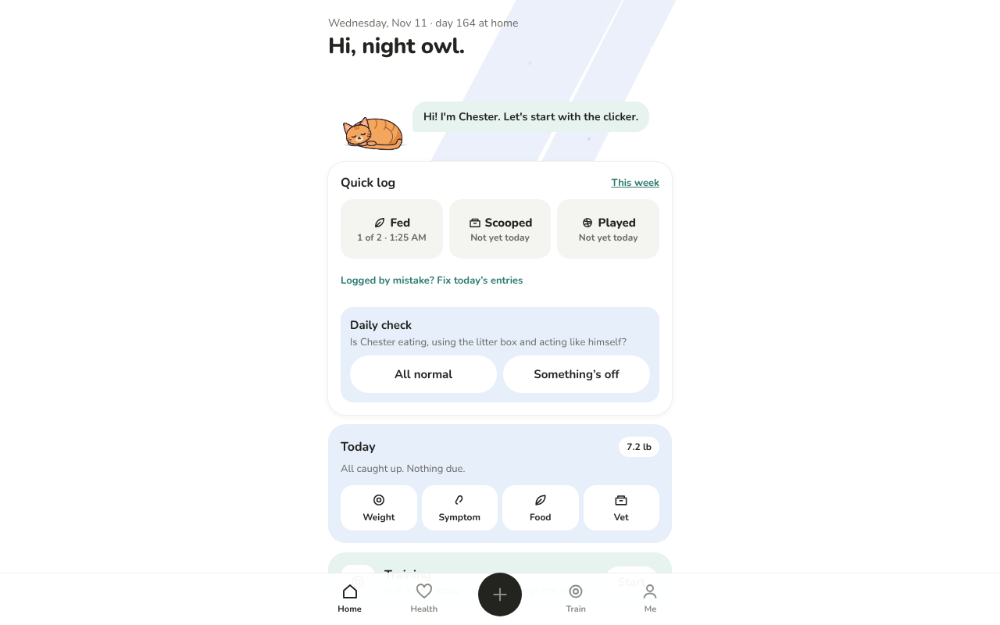
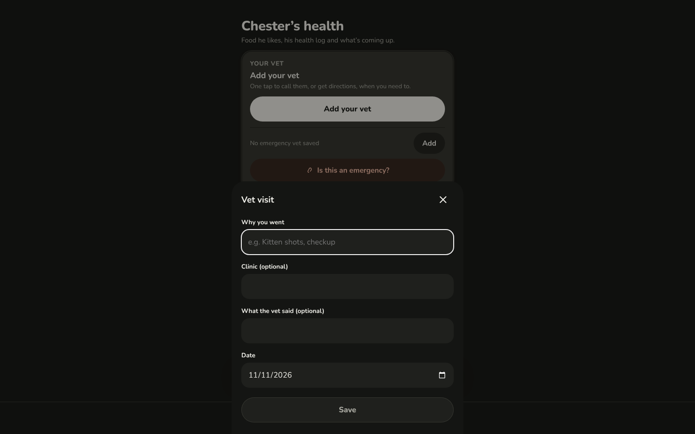

# Desktop website layout: design brief (agenda item 9)

Status: **approved by Josh, 2026-11-11** (answers in §8). No app code here; Features workers build it one step at a time.
Written by the UX reviewer, 2026-11-11, from the current app (main `6af06e2`) at 1280×800 (light) and 1440×900 (dark).

Goal: the same app, comfortable on a laptop or desktop. Still one codebase, and still exactly today's layout on phones.

## Today on desktop

| 1280 px, Home (light) | 1440 px, a log sheet (dark) |
|---|---|
|  |  |

- Every screen is a **480 px column** (`.screen{max-width:480px}`) with about 400 px of empty space on each side.
- The **tab bar** is a full-width strip fixed to the bottom of a 900 px tall window, with the round **+** sitting on it.
  On a laptop, the mouse has to travel to the bottom edge for every tab change.
- Only about **one and a half cards** fit above the fold on Home. Quick log fits, the Today card is cut off, and Friends, Training and the corner are
  2–3 screens down.
- **Sheets** (log forms, invite, etc.) slide up from the bottom, 480 px wide, and run under the bottom of a short
  laptop window. Save can end up below the fold, and the dimmed page behind looks broken at that width.
- Hover does nothing, focus rings are the browser default, there are no keyboard shortcuts, and Esc doesn't close sheets.
- The install step is already skipped on desktop (`platform() === 'desktop'`). Good.

## 1. What people do on desktop

Ranked by how likely they are at a desk:

1. **Reading and showing the vet things:** the Summary for the vet (on a big screen), documents
   (open, rename, sort), the visit history, adding the vet's details. Typing is easier with a keyboard.
2. **Uploading documents:** PDFs from email or Downloads, dragged in.
3. **Logging at a desk:** "Fed" and the daily check from a work laptop, catching up on a weigh-in or a med.
4. **Training stats and the skill tree:** charts and the tree have room to breathe.
5. **Friends and visiting cats, the corner, play:** casual. Play with the laser dot is *great* with a mouse.

Not desktop jobs: running a training session (that happens with the phone in hand, next to the cat). Keep it working, but
don't design for it.

## 2. Breakpoints and layout

| Width | Name | Layout |
|---|---|---|
| < 760 px | **phone** | Exactly today. No change. |
| 760–1099 px | **tablet** | A side rail (icons + labels, 88 px) on the left instead of the bottom tab bar; content column up to 640 px; sheets become centred dialogs. |
| ≥ 1100 px | **desktop** | A side nav (220 px, labels, the **+** as a "Log" button at the top); content area up to **1120 px**, centred; two-column grids on Home and Health; sheets become a **right-hand side panel** (420 px). |

Max widths: cards keep their phone look and never stretch wider than **560 px** each; the grid adds columns
instead of making cards wide. Body text stays at the phone size (16 px); line length is capped at about 70 characters.

**Side nav (desktop)**

```
┌───────────────┬──────────────────────────────────────────────┐
│ 🐾 PalDex     │                                              │
│               │                                              │
│ [ + Log ]     │   (content: 2 columns, max 1120 px)          │
│               │                                              │
│ ⌂ Home        │                                              │
│ ♡ Health      │                                              │
│ ◎ Train       │                                              │
│ ☺ Me     •    │                                              │
│               │                                              │
│ ( Luna )      │                                              │
│ ( Chester ✓ ) │  ← the pet switcher moves here               │
│               │                                              │
│ Sync: up to   │                                              │
│ date          │                                              │
└───────────────┴──────────────────────────────────────────────┘
```

## 3. Screen by screen

| Screen | Desktop change |
|---|---|
| **Home** | Two columns. **Left (wider):** the cat scene (bigger, see §5), Quick log and daily check, Today. **Right:** Friends' cats, Training, the corner, news cards (new friend, treat thanks). The Quick log Undo note becomes a toast at the bottom-right of the content area. |
| **Health** | Two columns. **Left:** Your vet, Visits (next/last), Coming up, Log something. **Right:** Documents (newest + All documents), Weight chart (wider), Food and treats. The Health log below spans both columns as a **table** (date · what · details · who). |
| **Vet summary** | A single column, 720 px, with a **Share** button. (No print stylesheet: Josh skipped it.) |
| **All documents / Visit page** | A two-pane layout: the list on the left, and the selected document's details and preview on the right (PDF/photo in an `<iframe>`/``). Drag-and-drop a file anywhere to add it. |
| **Train** | Stats and chart left, Learning now and today's sets right. **Skill tree:** wider, branches side by side. |
| **Session** (training) | Just centred, at phone width. Show a note: "Best on your phone, next to Chester." |
| **Corner** | The outfits/toys/cushions grids go from 2 to 4 columns. Bond card on the left at the top. |
| **Play** | The play area grows to 900×520 px. The mouse moves the laser dot without a click (hover = dot), and a click = "keep still". |
| **Friends / Visit** | Friends: the cards grid goes from 2 to 3–4 columns. Visit: the cat left and big, the treat card and stats right. |
| **Me (Settings), Week, Trophies, Library, Onboarding, Install** | **Just centred**, with a 640 px column. |

Sheets: on **tablet**, centred dialogs (max 520 px, max height 85vh, scroll inside, Save fixed at the
bottom of the dialog). On **desktop**, a right-hand side panel, so the page stays visible and readable while logging (e.g.
reading the last visit while adding the new one). Esc closes it; clicking the dim area closes it, as today.

## 4. Mouse and keyboard

- **Hover:** cards and buttons get a subtle hover (background one step darker, `cursor:pointer`), only under
  `@media (hover:hover)` so phones never get stuck-hover states. Tooltips on icon-only buttons (calendar, close,
  back) after about 500 ms.
- **Focus:** a visible focus ring for keyboard users only (`:focus-visible`, 2 px `--ink` outline, 2 px offset). It must be visible in
  both themes. Sheets/dialogs trap focus and return it to the button that opened them.
- **Keys:** only `Esc` to close a sheet or dialog, and Enter/Space on focused buttons as usual. No custom shortcuts (Josh: skip).
- **Drag and drop:** documents anywhere on Health or All documents.

## 5. The cat and the corner

- Home's cat scene scales up: the cat goes from 104 px to **160 px** wide on desktop, the speech bubble sits beside it,
  and the scene gets more floor (the chase, zoomies and the litter gag have room to run). Use the same SVG, larger `width`;
  the art is vector, so it stays crisp. Check that `.dash` (full-screen rainbow dash, `position:fixed;inset:0`) still
  looks right on a wide window. It probably needs a max width or a longer path.
- Two cats nuzzling: keep the same spacing ratio. Don't spread them across the wider column.
- Corner: the bond card's cat goes to about 180 px; item tiles keep their size, and the grid adds columns.
- Visit: the friend's cat at 260 px.
- Don't scale the cat with the window continuously: two fixed sizes (phone, desktop) keep the art predictable for
  the art session.

## 6. Light and dark

- Same tokens; no new colours. The side nav uses `--bg` with a 1 px `--line` divider; the active item is `--grey`
  with `--ink` text (dark: same tokens, already defined).
- The `.card.white` hairline and shadow (added in UX review #1) matter more on large white areas. Keep them.
- The side-panel sheet uses `--bg` with a left `--line` border and a soft shadow in light mode; in dark mode the panel is `--surface`
  so it separates from the page.
- Check the focus ring and the hover states in both themes (hover in dark: `--surface` one step lighter, not darker).

## 7. Build steps (ranked; each can ship on its own)

| # | Step | Size | Notes |
|---|---|---|---|
| 1 | **Breakpoints + side nav**: a `useLayout()` hook (`phone`/`tablet`/`desktop` from `matchMedia`), the tab bar becomes a side rail/nav at ≥ 760 px, and the pet switcher moves into the nav on desktop. `.screen` padding adjusts (no 110 px bottom pad when there's no tab bar). | M | Biggest single win. Phones untouched (snapshot-test the tab bar under 760 px). |
| 2 | **Sheets as dialogs / side panel** + Esc + focus trap. | M | One change in the shared sheet wrapper (`.overlay`/`.sheet`), used by every form. |
| 3 | **Focus rings, hover states, `cursor:pointer`** (CSS only, under `(hover:hover)` and `:focus-visible`). | S | Pure CSS in app.css. |
| 4 | **Home in two columns** + the bigger cat scene. | M | Approved (bigger cat: yes). Needs the art session to check the 160 px scene, the chase and the gags. |
| 5 | **Health in two columns** + the Health log as a table + drag-and-drop documents. | M | Builds on the vet redesign's sections. |
| 6 | **Documents two-pane with preview.** | M | |
| 7 | **Corner, Friends, Train, Tree grids** add columns; Play area bigger with hover-to-move laser. | M | Friends use desktop too, so the Friends and Visit layouts matter. |
| 8 | **Just centre** the rest (Settings, Week, Trophies, Library, Onboarding) at 640 px. | S | Mostly done by step 1's max widths. |

Each step: Playwright screenshots at 390, 820, 1280 and 1440 px, light and dark; the phone screenshots must match
today's.

## 8. Josh's answers (2026-11-11)

1. **Who uses the desktop site?** Josh, and **friends too**, so Friends, Visit and Play need care, not just Health.
2. **Side or top menu?** **Side menu**, as recommended.
3. **Keyboard shortcuts:** **skip**. Only Esc closes dialogs; the rest is normal tab/Enter.
4. **Bigger cat on desktop:** **yes** (160 px on Home, with an art check).
5. **Printable vet summary:** **skip**. Share is enough.
